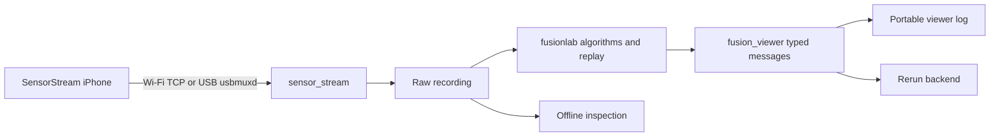

# 1. Project overview and architecture

Updated 2026-10-21. This describes what FusionLab is for and how the implemented
code is organized. Current quality and priorities are in
[2. Status and roadmap](2_status_and_roadmap.md); commands are in the
[README](../README.md).

## Purpose and objectives

FusionLab is an educational framework for implementing, understanding and
comparing localization and mapping methods, using an iPhone 17 Pro running the
SensorStream app and a Linux laptop. Python 3.12 is the language target.

Algorithms are implemented directly where that helps learning; established
implementations can sit behind adapters for comparison. The project supports
multiple approaches rather than converging prematurely on one fixed estimator.
EKF, visual/depth odometry, IMU preintegration, Forster-style VIO, mapping and
particle filtering are all in scope.

### Design goals

- Reusable sensor acquisition with a clear API and no mandatory ROS2 dependency.
- Explicit measurement units, timing, frames and calibration assumptions.
- Replayable recorded experiments, eventually sharing interfaces with live processing.
- Algorithms separated from acquisition and from visualization.
- A standalone viewer usable by other applications, initially through Python APIs.
- Readable, extensible, typed Python with meaningful tests.
- Real-map creation from captures or floor-plan imagery later; synthetic scenes
  serve verification rather than replace the real-world objective.

These are goals, not claims that all infrastructure exists.

## Package boundaries



| Package | Implemented responsibility | Does not promise |
| --- | --- | --- |
| `sensor_stream` | Transport, decoding, timestamps, bounded delivery, recording, inspection, live RGB preview | Automatic synchronization, calibrated geometry, localization |
| `fusionlab` | Measurement interpretations, replay, calibration and separate algorithm experiments | A generic configurable pipeline framework or production odometry |
| `fusion_viewer` | Sensor-independent validated messages, portable logs and Rerun rendering | Map editing, remote transport, guaranteed live backpressure handling |

Algorithms import acquisition models/readers where needed; the viewer does not
import SensorStream or FusionLab. OpenCV supports geometry and image processing;
Rerun is the visualization backend. CLI orchestration lives in each package.

Component details: [4. Sensors and acquisition](4_sensors_and_acquisition.md),
[5. Camera and visual odometry](5_camera_and_visual_odometry.md),
[6. Viewer](6_viewer.md), [7. Benchmarking](7_benchmarking.md).

## FusionLab source hierarchy

```text
src/fusionlab/
  __init__.py, __main__.py, cli.py       package and command entry points
  recordings/
    replay.py                          recorded IMU reading and timed replay
    euroc.py                           EuRoC cam0/calibration/ground-truth import
  inertial/
    measurements.py                    explicit IMU interpretation/conversion
    orientation.py                     gyro orientation baseline
    dead_reckoning.py                  exploratory position integration
  vision/
    calibration.py                     checkerboard target and intrinsic fitting
    calibration_validation.py          scoring fixed intrinsics on a separate capture
    feature_tracking.py                image correspondences and overlays
    tracks.py                          typed tracks.jsonl records (TrackFrame) and readers
    two_view.py                        uncalibrated pair geometry
    calibrated_motion.py               calibrated pair-motion diagnostics
    odometry/
      visual_odometry.py               multiframe estimator (MonocularOdometry)
      runner.py                        runs VO over tracks; writes poses, reports, summary
      landmark_refinement.py           landmark-only optimization
      local_bundle_adjustment.py       joint local pose/landmark optimization
  evaluation/
    ground_truth.py                    timestamp association and segment Sim(3) scoring
    vo_evaluation.py                   saved-run metrics and jump inspection
    vo_reports.py                      failure and geometry audit reports for a VO run
    vo_motion_diagnostics.py           common-map, CV, spatial and gyro analysis
  visualization/
    visualization_adapter.py           exports to fusion_viewer messages
    odometry_replay.py                 VO video/status/segment-path viewer replay
```

Other top-level folders:

| Location | Responsibility |
| --- | --- |
| `tests/` | Unit and integration tests (`test_*.py`, unittest discovery) |
| `examples/` | Synthetic viewer API demonstrations |
| `benchmarks/` | Local performance experiments and the external ORB-SLAM3 driver; not independent accuracy benchmarks |
| `scripts/` | Maintenance, including the data-layout audit/restore tool |
| `docs/` | These numbered documents and the printable `calibration_target/` |
| `data/sessions/` | Active captures and selected RGB calibration |
| `data/archive/` | Older sensor captures and superseded calibration attempts |

The CLI delegates to these packages. Evaluation may replay an estimator to inspect
its state; its diagnostic hypotheses do not feed estimator acceptance.
Visualization adapters understand FusionLab outputs, while `fusion_viewer` stays
independent. Optional numerical/rendering dependencies are loaded lazily.

Imports use the grouped paths, for example:

```python
from fusionlab.inertial.measurements import MeasurementConvention
from fusionlab.vision.odometry.visual_odometry import MonocularOdometry
from fusionlab.evaluation.vo_evaluation import summarize_run
```

Former flat imports such as `fusionlab.visual_odometry` were replaced; CLI names,
flags and output formats were preserved. Some modules still combine algorithms
with plotting, run orchestration or reporting; extracting those is a separate
refactor, not a delivered generic pipeline framework.

## Measurement and persistence boundary

A capture contains `metadata.json`, `events.jsonl`, `camera/` JPEGs and `depth/`
binary files where present. Source timestamps are preserved; monotonic and Unix
receive times describe laptop reception. Camera/depth assets have sizes and
SHA-256 hashes checked by readers. Interpretation of units and frames occurs in
processing; the receiver preserves wire values.

Raw capture, human route annotations and derived analyses are separate. Derived
run summaries record source paths and configuration; pose JSONL records statuses
and segment-local estimates. Existing output directories are generally rejected
to avoid mixing runs.

## Data layout

The [data index](../data/README.md) lists active captures, selected results and
the archive/compatibility policy. Each walking capture follows:

```text
walking/<capture>/
  metadata.json, events.jsonl, camera/, depth/   raw recording
  notes.md, route.json                         human route evidence
  README.md                                    capture entry point
  analysis/
    current/       selected tracks, VO, diagnostics, IMU baselines (for inspection)
    comparisons/   cross-run A/B tables, JSON and Markdown
    archive/       intermediate runs, audits, exports
    runs/          new experiments, one new directory each
```

"Current" means selected for inspection, not validated localization or a changed
CLI default. External benchmark inputs/outputs belong in `data/benchmarks/`.
`data/catalog.json` maps historical capture paths to canonical ones, and
`data/consolidation_manifest.json` records the 2026-10-18 data moves verified by
`scripts/restore_data_layout.py --check`.

## Not yet delivered

Shared interchangeable algorithm interfaces, a generic pipeline layer, continuous
visual–inertial estimation, map creation/editing, 3D mapping and particle-filter
localization are not delivered. Synthetic map/pose/particle rendering exists; it
is not a localization algorithm. The planned sequence is in the
[roadmap](2_status_and_roadmap.md#roadmap).

## Documentation history

Documentation was consolidated on 2026-10-18, and again on 2026-10-21 into
`AGENTS.md` (rules), `README.md` (commands) and these numbered documents.
The earlier `docs/archive/` folder referenced by some saved reports is not
present in this workspace.
